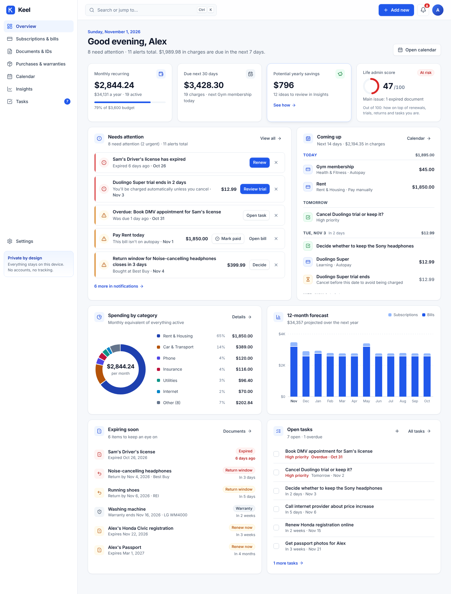
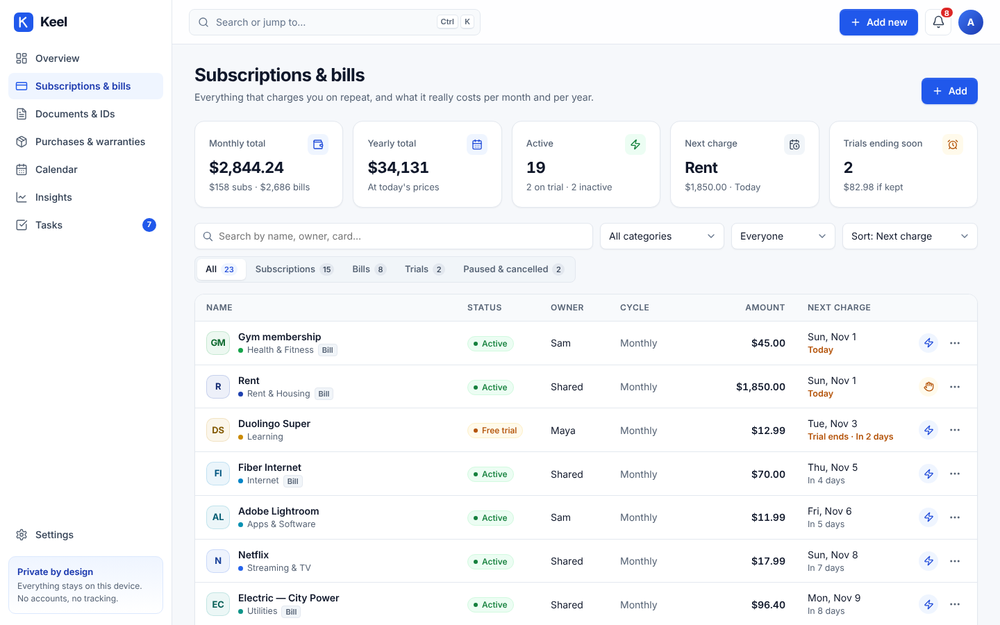
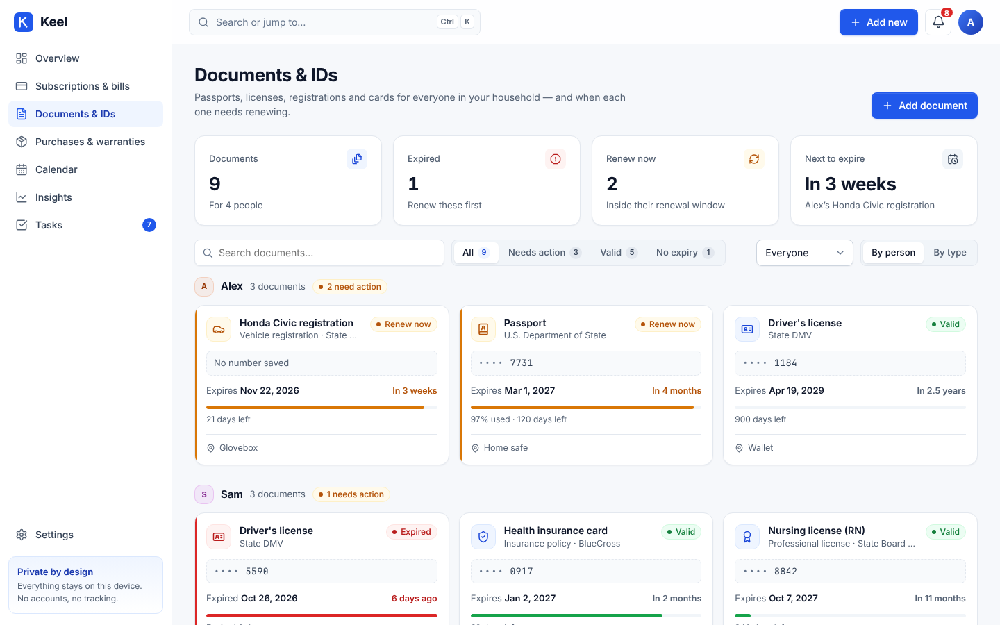
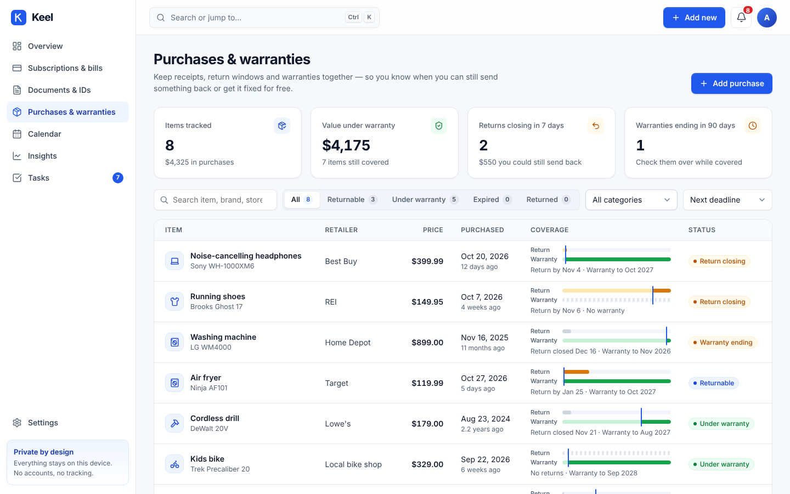
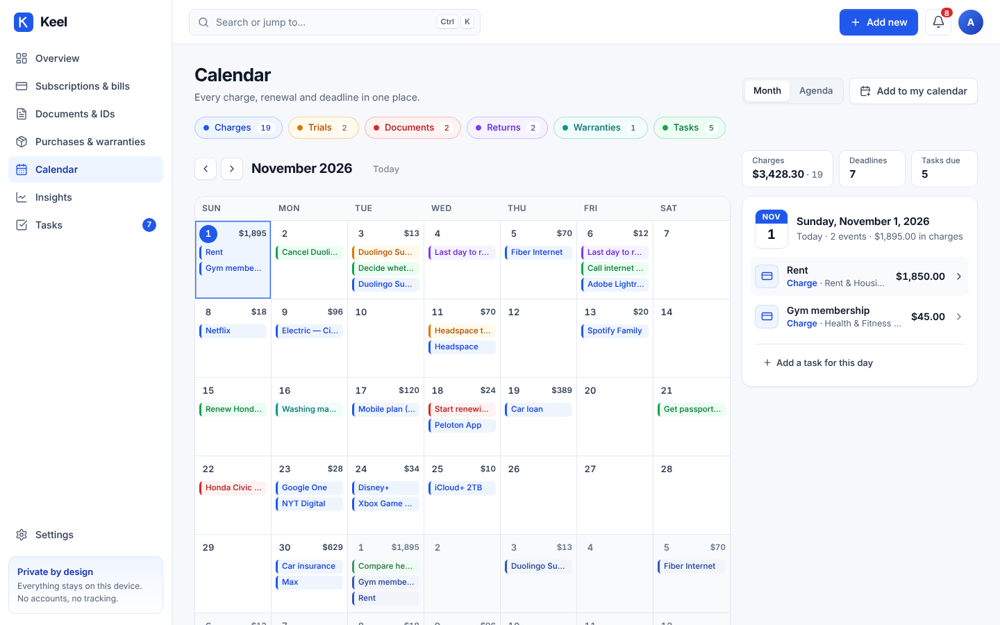
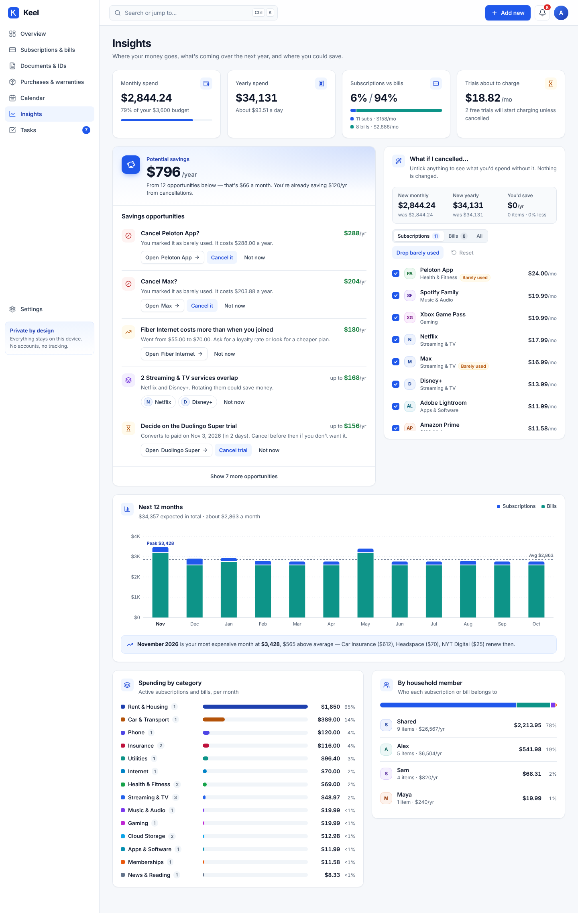
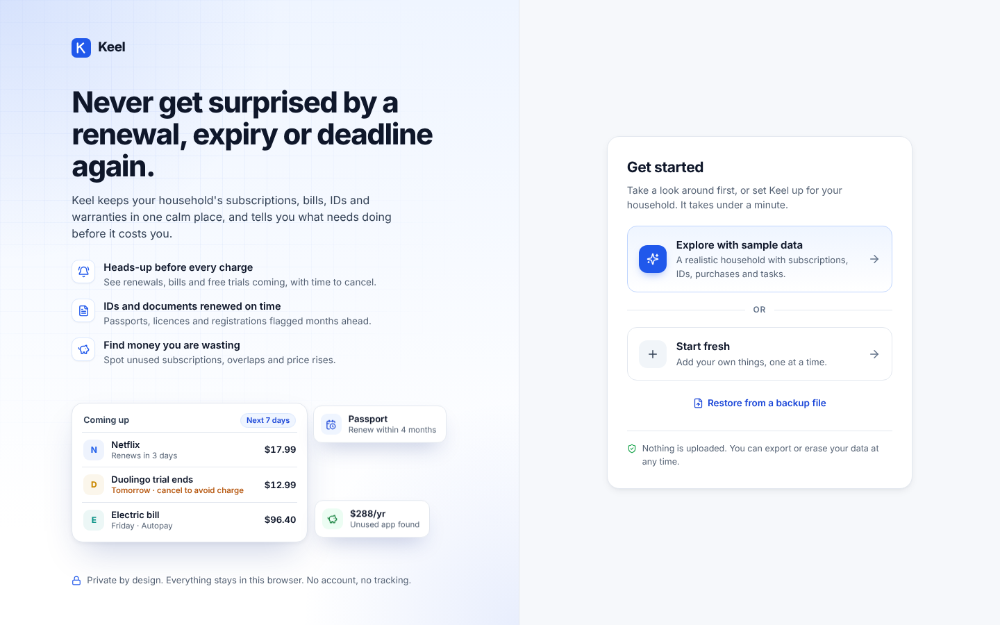
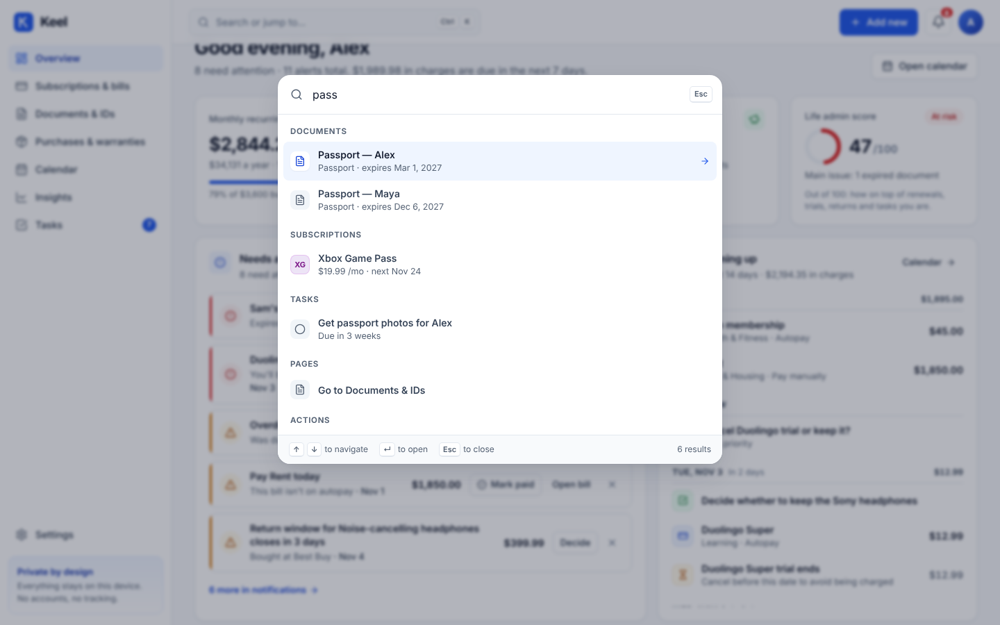

# Keel — life admin, handled

Keel is a private, local-first web app for everyday people. It tracks the recurring and expiring things that run a household, and warns you before any of them costs you money or becomes a hassle.

| Problem | What Keel does |
| --- | --- |
| Free trials quietly turn into paid plans | Shows every trial's end date and the amount it will charge, and warns you days ahead |
| Subscriptions add up without you noticing | Shows every recurring cost as a monthly and yearly figure, broken down by category and by person |
| A passport or license expires right before a trip | Opens a renewal window for each document months ahead, and its "Mark renewed" action asks for the new expiry date |
| Missing a return window or a warranty end date | Shows a coverage bar for every purchase and drafts the warranty claim email for you |
| Bills not on autopay get missed | Warns you before a manual bill is due, and lets you mark it paid |
| "Where is all my money going?" | 12-month forecast, savings ideas, and a "what if I cancelled…" simulator |

## Screens

- **Overview**: the life admin score, a "needs attention" list with one-click actions, the next 14 days, spending by category, the 12-month forecast, items expiring soon, and open tasks.
- **Subscriptions & bills**: search, filters and sorting. Each item has a detail panel with its price history, upcoming charges, pause, cancel and mark paid.
- **Documents & IDs**: grouped by person or by type, with validity bars, a renewal timeline and renewal checklists.
- **Purchases & warranties**: return and warranty bars, a copyable serial number, and the warranty-claim email writer.
- **Calendar**: month and agenda views, filters by type, and export of the next 12 months to an `.ics` file.
- **Insights**: savings ideas, the forecast, breakdowns, and the what-if simulator.
- **Tasks**: type a task in plain words ("cancel spotify friday") and the date is set for you. Tasks can be linked to any item.
- **Settings**: household members, currency and locale, budget, JSON backup and restore, CSV export, and erase.
- **Search (⌘K / Ctrl+K)**: find any item, page or action. There is also a notifications panel and a first-run setup screen.

## Gallery

| | |
| --- | --- |
|  |  |
|  |  |
|  |  |
|  |  |

## Architecture

```
src/
  lib/          pure domain logic, no React
    types.ts      domain model
    dates.ts      UTC-safe ISO date math (billing dates anchored to the same day each month, clamped to the month end)
    engine.ts     billing schedule, timeline, alerts, insights, health score
    money.ts      normalising amounts to monthly/yearly, currency formatting, parsing typed amounts
    meta.ts       labels, colours, defaults
  store/        reducer store, saving to localStorage with version upgrades, selector hooks, import checks
  components/ui design system: buttons, fields, modals, drawers, toasts, confirm dialog, menu
  app/          shell, routes, global editors and overlays
  features/     one folder per screen
```

- All data lives in `localStorage` under the key `keel:data`. Saved data carries a schema version, and import validates the file before replacing anything.
- `engine.ts` is the single source of truth. Every screen reads the same timeline, alerts and insights, so the numbers agree.
- No backend, no account, no tracking. There are no chart libraries: the charts are hand-built SVG.

## Run it

```bash
npm install
```

```bash
npm run dev
```

```bash
npm test
```

```bash
npm run build
```
