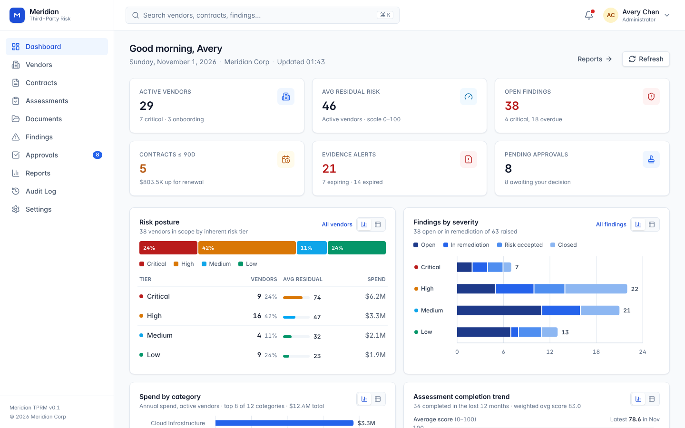

# Meridian — Third-Party Risk & Vendor Management

Meridian is an enterprise platform for managing the full lifecycle of third-party relationships: vendor onboarding, risk scoring, security due-diligence questionnaires, contract and obligation tracking, evidence (SOC 2 / ISO / insurance) expiry monitoring, finding remediation, segregation-of-duties approvals, and a tamper-evident audit trail.



## Why
Most companies track vendors in spreadsheets, contracts in a shared drive, and security questionnaires in email threads. Nobody can answer "which critical vendors have an expired SOC 2 and an open high-severity finding?" without a week of work. Meridian makes that a filter.

## Core modules
| Module | What it does |
|---|---|
| **Dashboard** | Risk posture, findings by severity, spend concentration, renewal and evidence expiry radar, personal work queue |
| **Vendors** | Inventory with inherent/residual risk scoring, tiering, data-access classification, onboarding wizard, contacts, 360° detail view |
| **Assessments** | Weighted questionnaires (SIG Lite / ISO 27001, Financial Viability, DORA/BCP), autosave, scoring, reviewer sign-off, findings raised inline |
| **Contracts** | Register with MSAs/SOWs/NDAs/DPAs, renewal windows, auto-renew flags, obligations, approval routing to procurement |
| **Documents** | Evidence library with issue/expiry tracking, review workflow, automatic expiring/expired status |
| **Findings** | Remediation tracker with SLAs, status workflow, risk-acceptance requests that require admin approval |
| **Approvals** | Role-routed inbox (onboarding → risk analysts, contracts → procurement, risk acceptance → admins) with segregation of duties |
| **Reports** | Risk by category, tier × status matrix, findings aging & MTTR, contract pipeline, compliance coverage, spend concentration, approval SLAs |
| **Audit log** | Every create/update/status change/decision with actor, entity and metadata; filterable and exportable |
| **Settings** | Organization thresholds, users & roles, questionnaire template builder |

## Risk model
- **Inherent risk (0–100)** = data access (none 5 / internal 25 / confidential 55 / restricted 80) + spend band (2–20) + category weight (1–10). Tier: critical ≥80, high ≥60, medium ≥35, else low.
- **Assessment score** = weighted % of Yes (1) / Partial (0.5) / No (0); N/A excluded. Rating: low ≥85, medium ≥70, high ≥50, else critical.
- **Residual risk** = inherent × (1 − 0.55 × latest completed score / 100) + open-finding penalty (critical 12, high 7, medium 3, low 1), clamped to 0–100.

## Stack
Node 22 (built-in SQLite, no native deps) · Express · Zod · React 18 · Vite · TypeScript · Tailwind v4 · TanStack Query · React Router · Recharts.

## Run locally
```bash
cd meridian
npm install
npm run dev        # API http://localhost:4000, web http://localhost:5173
```
The database is created and seeded with realistic demo data on first start (`server/data/meridian.db`). All demo accounts use the password `Meridian!2026`:

| Role | Email |
|---|---|
| Administrator | avery.chen@meridian.example |
| Risk Analyst | jordan.patel@meridian.example, priya.raman@meridian.example |
| Procurement | marcus.lee@meridian.example, sofia.martinez@meridian.example |
| Vendor Owner | daniel.okafor@meridian.example, hannah.weiss@meridian.example, liam.oconnor@meridian.example, noah.fischer@meridian.example |
| Auditor (read-only) | grace.kim@meridian.example |

Other commands:
```bash
npm test                 # API integration tests (node:test, in-memory SQLite)
npm run seed             # reset and reseed demo data
npm run build && npm start   # production build; server serves web/dist on :4000
```

## Project layout
```
meridian/
  server/   Express API, schema, risk engine, seed, tests
  web/      React SPA (pages per module, shared UI kit, charts)
  docs/     screenshots and product notes
```
See `CONTRIBUTING.md` for API conventions and UI guidelines.
